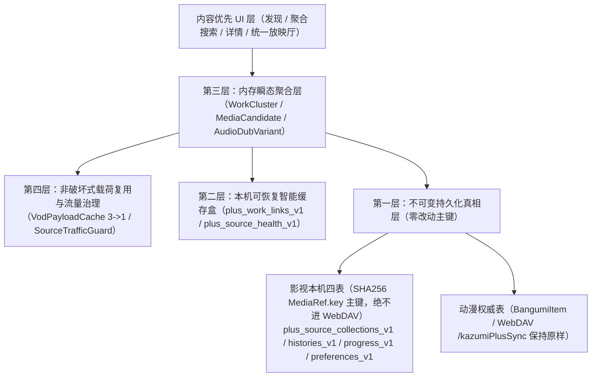

# Kazumi Plus 内容优先智能选源与「银盐放映室」全套 UI 重构方案

> **状态**：设计定稿（待确认后分阶段实施）  
> **适用范围**：Kazumi Plus 全三类内容（电影 / 电视剧 / 动漫）及四端形态（Windows / macOS / Android 手机 / Android TV）  
> **关联基线文档**：[docs/media-rules.md](media-rules.md)、[docs/unified-player-implementation.md](unified-player-implementation.md)、[docs/multi-platform-implementation.md](multi-platform-implementation.md)

---

## 一、现状核心痛点诊断（基于当前代码库实测）

当前版本将底层采集规则直接暴露到观影主链路，导致「找片—选源—播放—容灾—视觉」五个环节整体倒置：

1. **心智倒置（先盲选采集站，再找作品）**：
   - 进入电影/电视剧频道（`lib/pages/media/source_browse_page.dart`）必须先在 14 个采集站下拉框中盲选其一；各站分类 ID 互不相通，切换源站会丢失当前浏览上下文。
   - `lib/services/media/rule_media_catalog_service.dart` 中的静态 `_qualityPriority` 将实测仅 `800×448` 的 `kazumi-plus.maoyan` 与子清单分片失联的 `kazumi-plus.modu` 错误置顶，反而将实测 1080P 的 `iqiyi`、`zy360`、`hongniu` 与 4K 源 `4kav` 排至第 100 位；`source_browse_page.dart:85-98` 甚至将用户旧默认源强迁至 `maoyan`。
2. **搜索结果极度重复且无并发流量治理**：
   - `lib/pages/media/source_search_page.dart` 按来源平铺同一部电影/剧集，搜索一部热门片会重复出现 10+ 张相同海报，用户无法判断谁清晰、谁能播。
   - 动漫侧 `lib/services/plugin/plugin_search_service.dart:68` 对全部插件执行无节流 `Future.wait`，易瞬间触发站点风控或并发拥塞。
3. **3 次完全冗余的 MacCMS 请求与脏数据泄漏**：
   - 13 个 MacCMS 预置规则在 `discover` / `search` 阶段已通过 `ac=videolist` 拉回完整的 `vod_douban_id`、`vod_douban_score`、`vod_director`、`vod_sub`、`vod_play_from`、`vod_play_url`，但当前代码将其丢弃；进入 `SourceDetailPage` 后再连续发送第 2 次（`queryDetail`）和第 3 次（`queryPlaylist`）完全相同的 `ac=videolist` 请求。
   - `RuleMediaProvider._plainText` 仅执行单轮 HTML 解码，残留 `&amp;amp;amp;`；`modu` 年份带尾随破折号（`2026–`）；所有预置 JSON 将 `rating` 映射到采集站伪整数占位分 `$.vod_score`。
4. **播放器硬绑定单源、无源可切、遇障死等**：
   - `SourcePlaybackSession` 启动即死绑单一 `MediaRef`；`lib/pages/player/player_quality_sheet.dart` 面对单码率 HLS 源时只能弹出静态 `AlertDialog` 提示「仅提供一种画质，请更换片源」，却没有切源入口。
   - `HlsProxyService` 优先分片硬编码 `15s × 3` 重试（最长死等 45 秒）；播中卡顿不会自动切源；`haohua` 与 `xinlang` 共享同一 TS 分片上游，人工换源仍踩同一故障 CDN。
5. **UI 视觉模板化与跨端体验割裂**：
   - `lib/app_widget.dart` 在 `themeColor == 'default'` 时回退系统 `Colors.green`，`lib/pages/menu/menu.dart:262` 用 `colorScheme.primaryContainer` 包裹内容区，桌面 `NavigationRail` 使用 `groupAlignment: 1` 将导航压在底部，搜索入口按 `home.kind` 分裂跳转。
   - `lib/pages/player/player_adjustment_hud.dart` 残留 `blurRadius: 32` 发光外阴影；电影模式在播放器内仍展示无意义的「选集（第 1 集）」Tab；Android TV 缺少 5 秒自动隐藏 HUD、D-pad 免唤起寻址，且超 1 小时影片时间码显示异常。

---

## 二、全新架构设计：内容优先双层联邦与实测自愈统一播放架构

> **核心范式翻转**：从 **「选采集站 → 找片 → 盲播 → 报错退出重找」** 彻底转为 **「选想看的作品 → 自动推荐并探活最优片源 → 秒开直达 → 播中无感容灾与一键透明切源」**。  
> **坚持零外部 API Key、国内直连开箱即用**：不引入 TMDB 等需代理或密钥的外部元数据服务，充分复用 13 个 MacCMS 规则的 `ac=videolist` 完整载荷 + `4K-AV` 高清补充轨 + 本地实测遥测引擎。

### 2.1 四层数据与身份架构（严格守卫既有不变量）

1. **第一层（持久化真相层，100% 向后兼容）**：
   - 影视 4 张本地表继续使用 `sha256(utf8.encode(MediaRef.key))` 与 `sha256(utf8.encode(jsonEncode([ref.key, roadId, episode.key])))` 主键，严禁使用标题或临时媒体 URL 作 ID，严禁构造伪 `BangumiItem`，严禁进入 Bangumi 或 `/kazumiPlusSync` WebDAV。
   - 动漫继续以 `BangumiItem`（`MediaRef.bangumi(id)`）为唯一权威身份。
2. **第二层（新增 2 张本机可恢复辅助盒，损坏即自动重建绝不阻塞启动）**：
   - `plus_work_links_v1`（作品弱关联索引）：以 `workGroupKey`（`douban:<kind>:<id>:<dub>` 或 `fp:<kind>:<normTitle>:<year>:<dub>`）映射 `{ memberRefKeys, lastActiveRefKey, pinnedRuleId?, updatedAt }`。仅负责片单/历史展示层去重折叠、跨源续播取最新进度、切源后收藏状态同步与关联簇已下载集数汇总；真实收藏与进度始终按具体 `MediaRef.key` 写回原四表。
   - `plus_source_health_v1`（片源与 CDN 实测健康库）：持久化 `SourceRuleHealth`（按 `pluginIdentityKey + MediaKind` 键控）与 `CdnGroupHealth`（按动态提取的 TS 分片 CDN 归属组 `cdnGroup` 键控），经 `AsyncSerialQueue` 节流合并落盘。
3. **第三层（纯内存瞬态编排层 `lib/modules/media/work_cluster_models.dart`）**：
   - `AudioDubVariant`（`original / mandarinDub / cantoneseDub / taiwaneseDub / englishDub / unknown`）：将共享同一 `vod_douban_id` 的国配/粤语版显式拆桶为独立 `siblingDubClusters`，严禁混入原声候选池或自动容灾静默切音轨。
   - `VerifiedStreamProfile` 区分来源 `StreamProfileProvenance { mpvTrackList, m3u8MasterInf }`：**UI 画质徽章仅允许消费 `mpvTrackList` 实播解码结果**；`m3u8MasterInf` 仅作排序参考（×0.90 折算防清单虚标）。
   - `WorkCluster` 与 `MediaCandidate`：仅在会话内存中负责聚合展示、按评分排序与播中切换。
4. **第四层（非破坏式字段补读与 `VodPayloadCache`，3 次请求压缩为 1 次）**：
   - 在 `CatalogRuleStrategy._parseApi` 中对标准 MacCMS 键（`vod_douban_id`、`vod_douban_score`、`vod_director`、`vod_sub`、`vod_time`、`vod_content`、`vod_actor`、`vod_class`、`vod_play_from`、`vod_play_url`）执行**只读非破坏式补读**——无需递增预置规则 `version` 触发 `_replacePlugin` 覆写用户自定义 `baseURL`/请求头，并同步修复 `PluginsController._seedPlusRulesOnce` 保护用户改动。
   - 新增 `VodPayloadCache`（内存 LRU 上限 400 条，TTL 15 分钟，按 `MediaRef.key` 索引）：在 `discover`/`search` 解析 `ac=videolist` 行时直接预生成 `CachedVodPayload(detail, playlist, rich)`；`queryDetail` 与 `queryPlaylist(season: null)` 优先命中缓存，将 **3 次 `ac=videolist` 压缩为 1 次**（含显式 `season != null` 时严格禁用原作品缓存，按 `season.detailSource` 独立请求）。

---

### 2.2 全 16 源流量治理、K=3 锚点联邦发现与严苛防误并聚簇

1. **全局统一流量守卫（`SourceTrafficGuard`）**：
   - 统一托管全部 16 个预置源（13 MacCMS + `4kav` + `7sefun` + `DM84`）及用户自定义规则，覆盖发现、搜索、详情补全、探针与动漫 `PluginSearchService`：
     - 按规范化 `host` 隔离的 `AsyncRateLimiter(400ms)`；
     - 单 `host` 最大并发 `2`；全局后台并发上限联动 `PlaybackCachePolicy.isConstrained`（Wi-Fi/桌面 `4`，移动计量/低内存 `2`）；
     - 基于 `(host, method, normalizedUrl, queryHash)` 的 `AsyncSingleFlight` 并发请求去重。
2. **K=3 动态跨 CDN 锚点联邦发现（`FederatedCatalogCoordinator`）**：
   - 电影/电视剧首页默认进入「智能聚合视图（`auto`）」，**绝不对全部 14 源并发轰炸**，而是仅拉取 `K = 3` 个来自不同 `cdnGroup` 且未熔断/未 CAPTCHA 冷却的健康锚点源：
     - 冷启动默认锚点：`kazumi-plus.iqiyi` + `kazumi-plus.zy360` + `kazumi-plus.hongniu`（三者均经实测 1080P 且目录独立，彻底移出低清 `maoyan`、断链 `modu` 与同 CDN 的 `haohua`/`xinlang` 重复占位）；
     - 任一锚点熔断或触发 CAPTCHA 时，自动从不同 `cdnGroup` 的健康源池动态递补。
   - **电影频道 `4K-AV` 独立异步补充轨**：沿用 Safari UA + Referer 异步拉取，不阻塞首屏；既可按严苛规则桥接入主目录 `WorkCluster`，又在电影频道顶部呈现精选影院行（单片规格仍以实播解码为准，绝不硬贴全站 4K 标签）。
   - **统一语义分类与白名单校验**：本地映射 `CanonicalCategory`（电影：全部/动作/喜剧/爱情/科幻/悬疑/剧情/纪录/动画电影；剧集：全部/国产/欧美/日剧/韩剧/港台/海外）到各预置源分类 ID，运行期强制校验命中 `plugin.catalog.channels[kind].categoryIds` 白名单，防止综艺/体育/伦理混入。
   - **稳态分页 + 保留单源回退**：翻页时原地更新已展示卡片的聚合源计数，绝不重排造成视口跳动；筛选栏末端保留「按单源浏览」切换入口，同时彻底删除 `source_browse_page.dart:85-98` 强迁 `maoyan` 的历史补丁。
3. **脏数据深度标准化（`MediaTextNormalizer`）**：
   - **递归 HTML 解码**：循环调用 `html.parseFragment` 至收敛（上限 4 轮），替换 `RuleMediaProvider._plainText`，根治 `&amp;amp;amp;`；
   - **年份清洗**：提取 `(19\d{2}|20[0-3]\d)`，自动修剪 `2026–`、`(2025)` 等脏格式；
   - **诚实评分过滤**：仅采信 `vod_douban_score` 且 `0.0 < s <= 10.0`；屏蔽伪整数占位 `vod_score`（无有效豆瓣分时 `MediaSummary.ratingText = ''` 且同步修正 `MediaSort.rating`）；
   - **繁简折叠 + 精确集号扩展**：内置约 1500 字高频影名繁简表；`RuleMediaProvider._episodeNumber` 在严苛锚定下补充支持 `EP01`/`E01`（继续拒绝 `1080P`/`4K`/`S02E03` 误猜）。
4. **严苛两级聚簇防误并（`WorkClusterMatcher`）与按需全源补全（`SourceFanOutService`）**：
   - **全局硬互斥守卫**：(1) `kind` 不同禁并；(2) `dubVariant` 不同禁并（同豆瓣 ID 挂为 `siblingDubClusters`）；(3) 含 `seasonsPath` 多季容器不并入扁平单季簇；(4) `seasonToken` 不一致或单方标有第 2 季及以上禁并（`seasonToken` 仅作互斥守卫，绝不补造「第 1 季」）。
   - **Tier 1（豆瓣 ID 精确聚类）**：纯数字且 `>= 1000000` 归入 `douban:<kind>:<id>:<dub>`，附加反错填保护（若 `|yearA - yearB| > 2` 且标题/别名 Jaccard `< 0.2` 拒绝合并）。
   - **Tier 2（保守复合匹配）**：标题/别名交集非空 + 双方有年份时 `|yearA - yearB| <= 1`（彻底阻断《沙丘 2024》与《沙丘 1984》误并）+ 短名（≤2 字）或缺失年份强制要求导演交集；针对缺导演的 `4kav` 强制要求 **`yearDiff == 0` 且中文主名与英文别名双向同时命中**；剧集均标完结且总集数差 `> 20%` 时拆簇。
   - **按需全源补全**：从锚点进入详情或直接点播时，立即以已有候选渲染/起播，后台经 `SourceFanOutService`（跳过熔断与 30 分钟 CAPTCHA 冷却源，单源软超时 `3.5s`）在 `600–1200ms` 内补全其余健康源与 `4kav`。

---

### 2.3 实测驱动自动推荐评分、错峰对冲探针与 Make-Before-Break 容灾

#### 1. 动态评分公式（`SourceScoringEngine`）

废弃硬编码 `_qualityPriority`，所有候选源由实测健康度实时打分：

$$\text{Score} = A_{\text{avail}} \cdot (w_{\text{res}} S_{\text{res}} + w_{\text{speed}} S_{\text{speed}} + w_{\text{stab}} S_{\text{stab}}) + B_{\text{align}} + B_{\text{pin}} - P_{\text{cdn}} - P_{\text{lazy}}$$

| 优选模式 | $w_{\text{res}}$ (画质) | $w_{\text{speed}}$ (速度) | $w_{\text{stab}}$ (稳定) | 适用场景 |
| :--- | :---: | :---: | :---: | :--- |
| **`balanced`（默认均衡）** | 0.42 | 0.30 | 0.28 | 日常优先 1080P/4K 且兼顾秒开与不卡 |
| **`qualityFirst`（画质优先）** | 0.62 | 0.18 | 0.20 | 大屏/高速宽带优先 4K/高码率 |
| **`speedFirst`（流畅优先）** | 0.22 | 0.48 | 0.30 | 移动网络/弱网优先低延迟起播 |

- **$A_{\text{avail}}$**：健康 `1.0`；半开试探 `0.35`；熔断期内、已禁用或处于 30 分钟 `captchaCooldownUntil` 为 `0.0`（移出自动池，仅保留在手动面板标注原因）。
- **$S_{\text{res}}$**：`4K (≥3840×1440) -> 1.00`、`1440P -> 0.88`、`1080P (≥1920×720) -> 0.78`、`720P -> 0.55`、`≤480P (如猫眼 800×448) -> 0.28`、无样本中性 `0.50`。证据权重：本次实播解码 `1.0` > 探针 M3U8 `RESOLUTION` `×0.90` > 历史实测中位数 `×0.85`。
- **$S_{\text{speed}}$**：`0.6 * clamp(1 - log2(max(ttfbMs, 200)/200)/5.0, 0, 1) + 0.4 * clamp(throughputKbps/8000, 0, 1)`。
- **$S_{\text{stab}}$**：`startupSuccessRate * exp(-0.35 * stallRatePer10Min)`。
- **$B_{\text{align}}$ / $B_{\text{pin}}$**：精确集号/正片对齐 `+0.08`；`TC/TS/枪版/抢先` 扣 `-0.30`；用户当前作品锁定源 `+0.30`。
- **$P_{\text{cdn}}$（动态 CDN 相关性惩罚 `-0.45`）**：通过探针与 `HlsProxyService` 提取首个有效 TS 分片最终跳转 URL 归一化生成 `cdnGroup`（公有云 OSS/COS 保留桶前缀防误伤，私有采集分发域取 `eTLD+1 + 首段路径特征`）。当 `haohua` 失败时，自动将同 `cdnGroup` 的 `xinlang` 压低 `-0.45`，强制跨 CDN 容灾，**无需硬编码站群列表**。
- **$P_{\text{lazy}}$**：WebView 嗅探规则（`7sefun`/`DM84` 等）扣 `-0.25`；启用 `antiCrawlerConfig` 扣 `-0.35`。

#### 2. 精细化故障分级与 CAPTCHA 红线
- `tlsTransient`（偶发 TLS EOF / `BAD_RECORD_MAC`）：新建连接退避 `250ms` 自动重试 1 次，仍失败仅计 `0.5` 次故障，避免误杀健康 1080P 源。
- `http4xxGone`（单片/单集 404/410）：仅本次会话标记该集不可用，对站点仅轻罚 `0.25`，不连坐整站。
- `networkTimeout / http5xx / emptyPlaylist / decodeError`：`consecutiveFailures += 1`，触发指数退避熔断。
- **CAPTCHA 红线**：捕获 `CaptchaRequiredException` 或检测到 HTML 挑战页后，**绝不绕过或静默求解**，立即写入 30 分钟 `captchaCooldownUntil` 退出自动链路，仅在手动面板展示「需人工验证」供用户点击调用既有 `CaptchaVerificationService` 可见界面自行验证。

#### 3. 三级错峰对冲探针与零拷贝移交（`CandidateProbeOrchestrator`）
- **Tier-0（0ms 内存初筛）**：按 `SourceScoringEngine` 排序，优选来自不同 `cdnGroup` 的 Top-K（Wi-Fi/桌面 `K=3`，移动受限网络 `K=2`；若命中 `4kav` 且为电影频道则先以 Safari UA 拉取 `//video[@id='video1']//source`）。
- **Tier-1（0.8–2.0s 错峰对冲轻探针）**：
  - 主候选立即探测，若 350ms 未返回则错峰启动备选跨 CDN 候选；
  - HLS 探针不仅拉取 M3U8 清单，还必须检验首个有效分片可达性——**拦截 `modu` 类「主清单 200 但子清单/分片 404」假活源**；且不按 MIME 拦截伪装 `.png`/`.jpg` 的 TS 分片（按 HTTP 200/206 + 非 HTML + 长度 ≥1KB 判定），对 `AES-128` 密钥执行 16 字节快检。
  - 探测胜出后将 `(finalUrl, playlistBody, resolvedCdnGroup, fetchedAt)` 封装为 `HlsPreFetchedSeed`（`TTL <= 15s`）**零拷贝移交** `HlsProxyService.prepareSession`，省去播放器二次拉取清单，实现约 1 秒级秒开。
- **Tier-2（兜底 WebView）**：仅在直连/HLS 候选耗尽时按需触发。

#### 4. 播中卡顿监测与单 `mpv` Make-Before-Break 四阶渐进容灾
- **`PlaybackStallMonitor` 严苛布防门控**：仅在 `playing && !loading && !resumePending && !completed && !backgroundSuspended && !seeking && !withinPostSeekGrace(5s) && !quality.switching && !manualSwitchInProgress` 全部满足时计数。
- **四大触发条件**：
  1. 起播黑屏：`mpv` 致命打开/解码错误，或首帧出画前 `playerWidth == 0` 超 `12s`（直连/HLS）/ `20s`（WebView）；
  2. 持续卡顿：`playerBuffering` 且进度推进 `< 200ms` 持续 `8s`（桌面/Wi-Fi）或 `11s`（移动网络）；
  3. 高频再缓冲：60s 内发生 `≥3` 次 `≥2s` 缓冲且超前缓冲 `< 3s`；
  4. 代理优先分片死链：`HlsProxyService` 在 `failoverAware: true` 下将优先分片单次连接超时从 `15s` 收紧至 `6s`，连续 2 次尝试失败且缓冲 `< 4s` 即上报触发容灾。
- **本机断网止损**：若 `2s` 内来自 `2` 个独立 `cdnGroup` 的请求同时报底层网络不可达，立即判定为本机断网，停止无意义轮询切源并提示网络异常。
- **四阶渐进容灾（`FailoverController`，单 `mpv` 实例，绝不双实例爆显存）**：
  - **第 1 阶**：当前流多变体 HLS 降一档平滑切换（仅同流存在更低码率轨道时）；
  - **第 2 阶**：后台探活并热切至**异 `cdnGroup`** 最高分直连/HLS 候选（例如 `haohua` 卡顿自动跳过同 CDN 的 `xinlang`，直切 `iqiyi`/`zy360`/`hongniu`）；
  - **第 3 阶**：异 CDN 耗尽后尝试剩余未熔断同 CDN 候选；
  - **第 4 阶**：存在非 CAPTCHA 的 WebView 兜底时尝试嗅探，全部耗尽则进入独立 FocusScope 错误态提供「切换推荐片源 / 重试 / 返回」。
- **Android 续播与防覆写铁律（`SourcePlaybackSession` + `MediaResumeSession`）**：
  - 全部切集、手动切源、自动容灾串行进入现有 `AsyncSerialQueue` 并递增 `_generation` 丢弃过期回包；
  - 切源瞬间若仍在 `_resumePending`，**必须沿用 `_pendingResumeTargetMs` 绝不读取 `0ms` 覆写旧记录**；
  - 定位前将目标时间戳钳位至 `[0, max(0, newDuration - 15000)]` 防片头长度差异触发误完播；Android 端走 `MediaResumeSession`（首帧 + `AndroidVideoController.wid != 0` + `platform.lock.synchronized` + 位置回读确认；跨源切源容差由 `±3s` 显式放宽至 `±8s`，确认前锁死 `saveProgress()`）；
  - **电影播完绝不自动跳下一版本/下一片源**（严格维持 `media.ref.kind == MediaKind.tv` 门控）。

### 2.4 动漫 / 电视剧 / 电影三频道收敛
- **身份与数据严格隔离**：动漫保持 `BangumiItem` + `PopularPage`/`TimelinePage` + WebDAV `/kazumiPlusSync` + 弹幕/评论/SyncPlay；影视保持 `MediaRef.source` SHA256 本地四表 + 全平台隐藏弹幕/评论/SyncPlay。
- **底座与播中切换全面收敛**：
  - 动漫 `PluginSearchService` 接入同一 `SourceTrafficGuard`；
  - 13 个 MacCMS 规则跨 `anime`/`tv`/`movie` 共享 `SourceHealthRepository` 与 `CdnGroupHealth`（影视实测健康度直接反哺动漫 `SourceSheet` 排序，反之亦然）；
  - `PlayerPresentationContext` 新增对称可选接口 `PlayerSourceSwitchingFeatures? get sourceSwitchingFeatures => null`，由 `SourcePlaybackSession`（影视）与 `AnimePlayerPresentation`（动漫）共同实现，让动漫在 `VideoPage` 内同样支持统一「片源与清晰度」面板一键跨插件热切源与播中容灾（保留 `BangumiItem` 身份、保持弹幕时间轴同步、不触碰影视四表）。

---

## 三、全新视觉设计系统：「银盐放映室（Silver Halide Screening System）」

> **美学信条**：电影画面与作品海报是界面中唯一允许爆发色彩的主角；应用外壳应像 D65 校色暗房的哑光石墨墙面与美术馆冷银灰纸面一样中性、零色偏、低反光。

### 3.1 六项去模板化铁律（Anti-Cliché）
1. **废除 M3 默认绿与 Tonal 染色外壳**：淘汰 `Colors.green` 与 `colorScheme.primaryContainer` 包裹内容区的模板感，拒绝暖奶油/陶土红/酸绿霓虹/SaaS 紫蓝渐变；确立唯一校准强调色 **钨丝香槟金（Dark `#E5B95C` / Light `#946816`）**。用户选择自定义 `themeColor` 或 `useDynamicColor` 时，仅派生强调色与焦点色，**锁死 L0–L4 中性灰阶底面不被染色**。
2. **全播放器零 `BackdropFilter` / `ImageFilter.blur`（严守 Impeller 红线 `flutter/flutter#185506`）**：视频上方的全部 HUD、手势胶囊、自动容灾条与「片源与清晰度」抽屉 100% 禁止模糊滤镜，且彻底清除 `PlayerAdjustmentHud` 的 `blurRadius: 32` 彩色光晕；层次全部依靠 95% 高密哑光纯色底 + `1px` 内高光描边（`rgba(255,255,255,0.11)`）+ 非线性暗房 Scrim 构成。
3. **观影暗房锁定（Cinema Dark Lock）**：亮色模式（画廊冷银纸面）仅服务于日间发现与片单管理；一旦进入 `VideoPage` / `SourcePlayerPage` 路由，局部强制切入暗房 `KazumiThemeTokens`（联动 `oledEnhance`），彻底隔绝白底反光干扰观影。
4. **消除中点元数据垃圾与全大写眉标**：取消 DECORATIVE ALL-CAPS 眉标与 `2026 · 动作 · 美国 · HD` 式连串中点；改用「双空格间距 + 三级明度梯度 + 独立等宽微标」，海报卡下方严格限 2 行。
5. **拆除 M3 Card 外框套娃**：2:3 纯净海报直贴画布（`radius 10dp` + `1px` 内描边），无外层灰盒；拒绝装饰性 `01/02/03` 排行角标（等宽数字仅用于剧集选集网格）。
6. **尊重内置单字重 `MI_Sans_Regular` 约束**：全站仅使用 `FontWeight.w400` 与 `FontWeight.w600` 两档（禁用 `w500/w700/w800` 防单字重伪粗发糊），以字号比例 + 明度阶梯建立层级；所有时间码、集数、像素、码率与延迟强制启用 `FontFeature.tabularFigures()`。

### 3.2 `ThemeExtension<KazumiThemeTokens>` 色彩与空间规范

| 语义层级 | 暗房 Dark（默认） | OLED 纯黑联动 | 画廊亮色 Light | 用途说明 |
| :--- | :--- | :--- | :--- | :--- |
| `bgCanvas` (L0) | `#0B0C0E` | `#000000` | `#F5F6F8` | D65 深石墨主画布 / 冷银画廊纸面 |
| `surfaceBase` (L1) | `#121316` | `#000000` | `#FFFFFF` | 侧栏、底栏、顶栏、伴随侧板 |
| `surfaceElevated` (L2) | `#191C22` | `#0A0B0E` | `#ECEEF2` | 搜索框、选集块、筛选胶囊、候选源卡 |
| `surfaceOverlay` (L3) | `#21252D` | `#12141A` | `#FFFFFF` | 普通弹窗、下拉菜单（亮色附极轻中性影） |
| `playerHudSurface` | `#14161AF2` | `#0A0B0DF8` | *(暗房锁定)* | 视频上零模糊抽屉 / 手势胶囊 / 容灾条 |
| `hairline` / `overlayRim` | `#FFFFFF12` / `#FFFFFF1C` | `#FFFFFF1E` / `#FFFFFF26` | `#E2E5EC` / `#CCD2DE` | 1px 精密结构分隔线与浮层内高光边 |
| `textPrimary / Secondary / Muted` | `#F2F3F5` / `#A3A8B3` / `#6E7482` | `#EAECEF`*(抗拖影)* / `#A3A8B3` / `#6E7482` | `#111318` / `#525866` / `#7E8594` | 17.5:1 极高可读性三阶文字 |
| `accentPrimary` / `onAccent` | `#E5B95C` / `#14110A` | `#E5B95C` / `#14110A` | `#946816` / `#FFFFFF` | 钨丝香槟金主按钮、进度条、激活指示线 |
| `tier4kHdr` *(实测确认)* | 底 `#2B2212` 字 `#F0C66B` | 同左 | 底 `#FBF3E0` 字 `#855C10` | 仅 `mpv` 实播确认 4K 点亮 |
| `tier1080p` *(实测确认)* | 底 `#172330` 字 `#85B6E8` | 同左 | 底 `#ECF4FC` 字 `#22588F` | 仅 `mpv` 实播确认 1080P 点亮 |
| `statusHealthy / Warning / Danger` | `#45B583` / `#E39B44` / `#E05B63` | 同左 | `#1D784F` / `#B56812` / `#C0323C` | 独立 CDN / 容灾与需验证 / 失效与危险操作 |
| `tvFocusRing` | `#F0C66B` (2.5dp 实线) | `#F0C66B` | `#F0C66B` | 10-Foot TV / 键盘无模糊锐利焦点框 |

- **圆角与空间网格（严格 4dp 步进）**：`posterRadius: 10dp`（TV `12dp`）、`episodeCellRadius / chipRadius: 8dp`、`cardRadius / controlRadius: 12dp`、`drawerSheetRadius: 16dp`；移动端热区强制外扩至 `≥ 44×44dp`，桌面主内容区上限宽 `1480dp`，Android TV 严格留足 `5%` Overscan 安全区（水平 `48dp` / 垂直 `27dp`）与 `≥ 16dp` 焦点间距。

### 3.3 核心界面与多端人机工程蓝图

1. **导航外壳重构（`lib/pages/menu/menu.dart`，100% 兼容 4 条既有路由 `/popular`, `/timeline`, `/collect`, `/my`）**：
   - 桌面端改为顶部对齐可收折侧栏（宽 `216dp` / 图标轨 `72dp`）：品牌标识 → 统一全局搜索入口（提示 `Ctrl+K` / `Cmd+K`）→ 4 大一级目的地（发现 / 时间表 / 片单 / 我的，左侧 `3dp` 钨丝金激活条）→ 底部下载微标与收折键。
   - macOS 非全屏顶栏统一包裹 `EmbeddedNativeControlArea(requireOffset: !isFullscreen)` 预留 `22px` 交通灯安全区；Android 手机采用 `64dp` 紧凑底栏；Android TV 采用 `184dp` 暗房导轨（焦点移入内容区柔降至 72% 亮度，保留左越界焦点回接记忆）。
2. **发现首页（重构 `media_home_page.dart` + `source_browse_page.dart`）**：
   - 顶栏集成 `[电影 | 电视剧 | 动漫]` 分段胶囊 + 全局搜索栏 + 末端低频「按单源浏览」开关；
   - 宽银幕 Hero Spotlight（`智能播放 自动优选` + `详情` + `加入片单`）+ 条件渲染「继续观看」横滑架 + 语义分类胶囊 + 2:3 无套娃作品栅格。
3. **全局聚合搜索（统一合并 `/search/` 与 `source_search_page.dart`）**：
   - 支持片名/英文原名/别名/导演并发检索；频道胶囊 `[全部 | 电影 | 电视剧 | 动漫]` + 右端 `[按来源分组]` 对比开关；
   - 单行透明遥测条汇报已检源数、去重作品数及需人工验证来源入口（点击弹出 `MediaCaptchaDialog`）。
4. **作品详情页（重构 `source_detail_page.dart`）**：
   - 零选源心智主行动栏：钨丝金主按钮 **`智能播放  自动优选`**（有断点显示 **`继续观看  第 4 集 14:22`**）+ 紧贴右侧的 **`智能优选状态胶囊`**（如 `已优选 4KAV  实测 4K  48ms ▾`，未实测绝不虚标），一键拉起右侧「片源与清晰度」抽屉。
   - 电影形态隐藏冗余「选集（第 1 集）」，直接平铺「可用片源与语言版本」列表；电视剧/动漫形态呈现 50 集自动分段 + 5–6 列等宽数字宫格（支持切换标题列表）；仅存在显式 `detail.seasons` 时渲染季切换器。
5. **统一放映厅播放器 & 「片源与清晰度」暗房抽屉**：
   - 顶部控制条展示实时片源与画质胶囊（1 键拉起抽屉），底部时间码统一调用 `durationToString` 呈现 `HH:MM:SS / HH:MM:SS`；
   - **三片种自适应伴随区**：电影直接展示「片源与简介」；电视剧展示 `[选集 | 片源与详情]`（严禁出现弹幕与评论）；动漫保留 `[选集 | 评论]` 与完整弹幕体系。
   - **一体化「片源与清晰度」暗房抽屉**（桌面右滑 `380dp` / 手机底弹 `72%` / TV 右侧 `420dp` 独立 FocusScope）：实时解码遥测条 → 自动容灾开关与偏好策略 → 多语言版本筛选（条件显示）→ 按实测排序的候选源卡（含独立 CDN / 同源镜像指示与当前流多码率子轨）→ 折叠展示故障与需人工验证源。
6. **Android TV 10-Foot 专项修复（`tv_playback_controls.dart` + `tv_focus.dart`）**：
   - 新增 5 秒无操作自动隐藏 HUD、D-pad 左右免唤起直达 `±10s/±30s` 寻址、Up 键 1 步拉起右侧片源与选集导轨；
   - 严守两段返回栈（有导轨先关导轨 → 有 HUD 第 1 下收 HUD 回 `_surfaceFocus` → 第 2 下落盘退出）及 `_statusFocusScope` 焦点隔离。

---

## 四、四阶段工程实施路线图

| 阶段 | 核心交付目标 | 关键涉及文件 | 核心验收门槛 |
| :--- | :--- | :--- | :--- |
| **Phase 1：数据底座、MacCMS 3→1 复用与 16 源流量治理** | 建立双层身份模型、`MediaTextNormalizer`、两级防误并 `WorkClusterMatcher`、`VodPayloadCache`（非破坏式补读）、`SourceTrafficGuard`，修复伪评分与用户规则防覆写。 | `media_models.dart`、`work_cluster_models.dart`(新)、`media_text_normalizer.dart`(新)、`work_cluster_matcher.dart`(新)、`vod_payload_cache.dart`(新)、`source_traffic_guard.dart`(新)、`catalog_rule_strategy.dart`、`rule_media_catalog_service.dart`、`plugins_controller.dart` | `flutter analyze` 0 error/0 warning；单测覆盖 4 轮 HTML 解码、年份清洗、伪评分屏蔽、音轨拆簇、翻拍/多季防误并、`VodPayloadCache` 0 额外请求与不覆写用户规则；全量 `flutter test` 绿灯。 |
| **Phase 2：实测健康评分、对冲探针、播中热切与自愈容灾** | 落地 `plus_source_health_v1`、`SourceScoringEngine`、`CandidateProbeOrchestrator`（含分片可达性检验与 `HlsPreFetchedSeed` 零拷贝）、`PlaybackStallMonitor`、`FailoverController`、统一「片源与清晰度」面板与 Android `MediaResumeSession` 跨源续播。 | `source_health_repository.dart`(新)、`source_scoring_engine.dart`(新)、`candidate_probe_orchestrator.dart`(新)、`playback_stall_monitor.dart`(新)、`failover_controller.dart`(新)、`hls_proxy_service.dart`、`playback_quality.dart`、`media_resume_session.dart`、`player_presentation_context.dart`、`player_quality_sheet.dart`、`source_playback_session.dart` | 静态检查播放器叠加层零 `BackdropFilter`/`ImageFilter.blur`；单测覆盖 448P 降权、同 CDN `-0.45` 惩罚、假活清单拦截、`.png` 伪装分片放行、AES-128 校验、断网止损、`_resumePending` 绝不写 0ms、电影不自动跳版本。 |
| **Phase 3：内容优先联邦浏览、聚合搜索与「银盐放映室」全站 UI 重构** | 落地 `KazumiThemeTokens`（暗房/OLED/亮色/暗房锁定）、导航壳层重构、`FederatedCatalogCoordinator`（K=3 锚点 + 4K-AV 轨）、`SourceFanOutService`、聚簇搜索、零选源详情页及 `plus_work_links_v1` 片单/历史无损折叠。 | `kazumi_theme_tokens.dart`(新)、`app_widget.dart`、`theme.dart`、`menu.dart`、`federated_catalog_coordinator.dart`(新)、`source_fanout_service.dart`(新)、`source_media_library.dart`、`media_home_page.dart`、`source_browse_page.dart`、`source_search_page.dart`、`source_detail_page.dart`、`collect_page.dart`、`history_page.dart` | 存量 `plus_source_*_v1` 夹具 100% 兼容校验；验证详情零冗余请求、单源回退可用、停用源一键替代源续播、删除历史级联清理、无 M3 Card 套娃与中点垃圾。 |
| **Phase 4：动漫 + 电视剧 + 电影三频道收敛与全平台回归验收** | 将动漫 `PluginSearchService`、`SourceSheet`、`VideoPage` 与 `AnimePlayerPresentation` 接入统一流量守卫、健康评分与播中热切容灾；补齐 Windows / macOS / Android / Android TV 全端回归验收。 | `plugin_search_service.dart`、`source_sheet.dart`、`info_page.dart`、`video_playback_args.dart`、`video_controller.dart`、`video_page.dart`、`anime_player_presentation.dart`、`tv_playback_controls.dart`、`tv_focus.dart`、`player_menu_service.dart`、`pip_utils.dart` | 独立记录五类验证证据：(1) 静态分析；(2) 全量单元+Widget 测试；(3) `scripts/inspect_media_sources.dart` 低频抽样；(4) `scripts/package_plus.ps1` 构建产物；(5) Windows / Android 手机 / Android TV 实机与模拟器音画、容灾、TV 焦点与能力门控验收。 |

---

## 五、不变量合规审查结论（14/14 全部通过）

- **数据库主键与数据隔离**：影视四表严格沿用 `SHA256(MediaRef.key)` 主键且绝不进入 Bangumi / `/kazumiPlusSync` WebDAV；新增 `plus_work_links_v1` / `plus_source_health_v1` 为本机可恢复辅助盒，损坏自动重置不崩主库。
- **反虚标与数据诚实**：绝不为规则名附加未经逐片实测的 4K/蓝光/无水印标签；画质徽章仅消费 `mpv` 实播解码参数；屏蔽伪 `vod_score`，缺失评分直接隐藏；绝不推断「第 1 季」，绝不凭单标题盲目合并翻拍/跨季/不同配音版本。
- **反爬合规**：绝不绕过或静默求解 CAPTCHA，检测挑战后立即冷却 30 分钟并仅开放用户可见界面人工验证。
- **播放器与多端红线**：全播放器叠加层零 `BackdropFilter`/`ImageFilter.blur`；Android 续播严格经 `MediaResumeSession` 回读确认前绝不覆写 0ms；电影播完绝不自动切下一版本；影视全平台隐藏弹幕、评论与一起看；Android TV 维持独立 `_statusFocusScope` 与两段返回栈。
